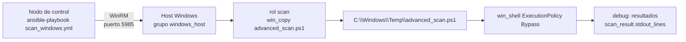

# ansible-winscan

Playbook de Ansible para escanear hosts Windows en busca de vulnerabilidades y posibles puertas traseras usando scripts PowerShell (winrm).

[](LICENSE)
[](https://github.com/bi0punk/ansible-winscan/actions/workflows/ci.yml)

## Contenido

- [Características](#características)
- [Arquitectura](#arquitectura)
- [Stack](#stack)
- [Estructura del repositorio](#estructura-del-repositorio)
- [Instalación](#instalación)
- [Uso](#uso)
- [Configuración](#configuración)
- [Tests / CI](#tests--ci)
- [Roadmap](#roadmap)
- [Licencia](#licencia)

## Características

- Escaneo automatizado de hosts Windows vía Ansible (WinRM).
- Detección de vulnerabilidades y configuraciones inseguras mediante scripts PowerShell (`scan.ps1`, `advanced_scan.ps1`).
- Inventario YAML flexible para targets con credenciales vía Ansible Vault.
- Rol reutilizable `scan` que sube y ejecuta el script en el host objetivo.

## Arquitectura



## Stack

- Ansible (colecciones Windows/WinRM)
- YAML (inventario y playbooks)
- PowerShell (scripts de escaneo)

## Estructura del repositorio

```
ansible-winscan/
├── inventory.yml            # Inventario de hosts Windows (WinRM)
├── scan_windows.yml         # Playbook principal
├── collections/requirements.yml
├── roles/
│   └── scan/
│       ├── tasks/main.yml
│       └── files/
│           ├── scan.ps1
│           └── advanced_scan.ps1
├── tests/
├── .env.example
├── .github/workflows/ci.yml
└── LICENSE
```

## Instalación

Requisitos: nodo de control Ansible (Linux), hosts Windows con WinRM habilitado y PowerShell Execution Policy configurada.

```bash
git clone https://github.com/bi0punk/ansible-winscan.git
cd ansible-winscan

# Instalar colecciones necesarias
ansible-galaxy collection install -r collections/requirements.yml
```

## Uso

```bash
# Editar inventario con tus hosts Windows
vim inventory.yml

# Ejecutar playbook de escaneo
ansible-playbook scan_windows.yml

# Escaneo específico por tag
ansible-playbook scan_windows.yml --tags security
```

## Configuración

Los parámetros reales se definen en `inventory.yml`:

| Parámetro | Ejemplo | Descripción |
|---|---|---|
| `ansible_host` | `192.168.1.146` | IP del host Windows |
| `ansible_user` | `automation` | Usuario WinRM |
| `ansible_password` | `{{ vault_windows_admin_password }}` | Contraseña (protegida con Ansible Vault) |
| `ansible_connection` | `winrm` | Conexión Windows |
| `ansible_winrm_transport` | `ntlm` | Transporte de autenticación |
| `ansible_port` | `5985` | Puerto WinRM |

Referencias adicionales documentadas en `.env.example`: `ANSIBLE_INVENTORY`, `WINRM_USER`, `WINRM_PASSWORD`.

## Tests / CI

```bash
# Validar sintaxis del playbook
ansible-playbook --syntax-check scan_windows.yml
```

CI: GitHub Actions (`.github/workflows/ci.yml`) ejecuta `ansible-playbook --syntax-check *.yml` en cada push y PR.

## Roadmap

- [x] Escaneo básico con scripts PowerShell
- [x] Validación de sintaxis en CI
- [ ] Más checks de seguridad (CIS benchmarks)
- [ ] Generación de reportes HTML
- [ ] Integración con SIEM
- [ ] Tests con molecule + vagrant

## Licencia

MIT — ver [LICENSE](LICENSE).